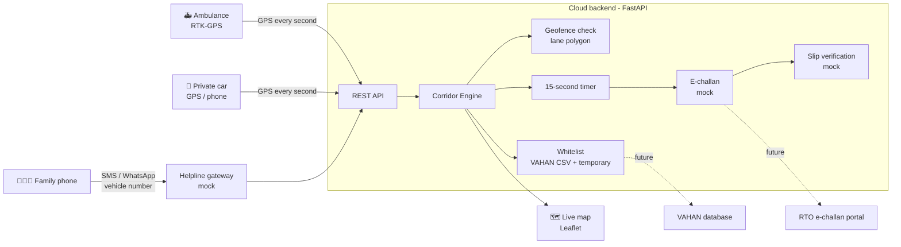

<h1 align="center">🚑 Smart GPS Geofenced Emergency Corridor System</h1>

<p align="center">
  <b>A virtual green lane for ambulances. 100% software. Zero road hardware.</b><br>
  Hackathon project for <b>HSC 2027 (MY Bharat)</b> · Team: <b>Vishesh Sharma &amp; Yash Jaiswal</b>
</p>

<p align="center">
  
  
  
  
  
</p>

> **Note:** This is a working **software prototype** made for a hackathon.
> It uses **demo data** (fake number plates, a sample lane on a map).
> It is **not** connected to any real RTO, VAHAN, 112 or e-challan system.

---

## 1. The Problem

In crowded Indian cities, ambulances often get stuck in traffic jams and patients lose
critical time on the way to hospital.

- Physical "green corridors" need police on the road and costly hardware.
- A private car carrying a patient gets no priority at all.
- Drivers who block the emergency lane face no quick action.

## 2. Our Solution

A **virtual geofenced emergency lane** on the **leftmost lane** of an existing road.
No new road hardware, only GPS + software.

| Who | What happens |
|---|---|
| 🚑 Ambulance (RTO/VAHAN whitelisted) | Enters the lane freely using high-precision RTK-GPS |
| 🚗 Private car enters the lane | GPS detects it, a **15-second grace timer** starts |
| 👨‍👩‍👧 Family carrying a patient | Sends the vehicle number by **SMS/WhatsApp** to the helpline (e.g. 112) → **temporarily whitelisted**, timer stops |
| ⛔ Car still in the lane after 15 s | **Automatic e-challan** (via the RTO portal in the real system) |
| 🏥 Genuine emergency | Upload a **hospital/clinic slip** through the helpline → slip is verified → **fine waived** |

## 3. Features (working in this prototype)

- ✅ Geofence check: is a GPS point inside the lane polygon? (`shapely`)
- ✅ VAHAN-like whitelist from a CSV file (fake plates)
- ✅ 15-second grace timer, cancelled if the car leaves in time
- ✅ Mock SMS/WhatsApp helpline endpoint: finds the plate in the message, whitelists it for 30 minutes
- ✅ Mock e-challan generation
- ✅ Hospital/clinic slip upload with a mock verification step → waiver approved or rejected
- ✅ REST API with automatic docs (`/docs`)
- ✅ Simulator that moves 6 vehicles along real GPS points
- ✅ Live web map (Leaflet + OpenStreetMap) showing the lane, vehicles, timers and challans
- ✅ 14 automatic tests (`pytest`)

## 4. Architecture



More detail: [docs/architecture.md](docs/architecture.md)

## 5. How it works (step by step)

1. The emergency lane is drawn once on the map as a **polygon** (`sample_data/corridor_lane.geojson`).
   In the demo it is the leftmost lane of Aurobindo Marg (southbound) in New Delhi, going towards AIIMS.
2. Every vehicle sends its **GPS position** (`POST /api/gps`).
3. The server checks: is the point **inside the lane polygon**?
4. If yes, is the plate **whitelisted**?
   - In the VAHAN-like list (ambulance, fire, police) → `ACCESS_GRANTED`
   - Temporarily whitelisted by the helpline → `ACCESS_GRANTED`
   - Not whitelisted → `TIMER_STARTED` (15 seconds) and a warning
5. During the 15 seconds:
   - Car leaves the lane → `LEFT_IN_TIME`, no fine
   - Family SMSes the vehicle number to the helpline → `TEMP_WHITELISTED` + `TIMER_STOPPED`
6. After 15 seconds, still inside → `E_CHALLAN_ISSUED` (mock).
7. The owner uploads a hospital/clinic slip (`POST /api/challans/{id}/waiver`):
   - checks pass → `WAIVER_APPROVED`, the challan is waived
   - checks fail → `WAIVER_REJECTED`, with the reasons

## 6. Tech Stack

| Part | Technology |
|---|---|
| Language | Python 3.10+ |
| Backend API | FastAPI + Uvicorn |
| Geofencing | Shapely (point-in-polygon) |
| Data | CSV + GeoJSON + JSON (demo files) |
| Map | Leaflet.js + OpenStreetMap tiles |
| Tests | pytest |
| Real system (planned) | RTK-GPS modules, cloud server, SMS/WhatsApp gateway, VAHAN & e-challan APIs |

## 7. Folder Structure

```
smart-gps-emergency-corridor/
├── app/
│   ├── main.py          # FastAPI server (all API endpoints)
│   ├── engine.py        # Corridor logic: geofence + whitelist + 15 s timer + challan
│   ├── geofence.py      # Point-inside-lane check (shapely)
│   ├── whitelist.py     # VAHAN-like list + temporary helpline list
│   ├── challan.py       # Mock e-challan + mock slip verification
│   ├── config.py        # All settings (15 s, 30 min, file paths)
│   └── static/map.html  # Live map (Leaflet)
├── sample_data/
│   ├── corridor_lane.geojson     # The virtual lane polygon
│   ├── vahan_whitelist.csv       # Fake emergency vehicle plates
│   ├── hospitals.csv             # Hospitals/clinics accepted for waivers
│   ├── routes.json               # GPS tracks for 6 demo vehicles
│   └── sample_hospital_slip.png  # Fake slip used in the demo
├── docs/
│   ├── architecture.md
│   ├── api.md
│   ├── simulation_log.txt        # Output of the simulator
│   └── screenshots/              # Live map screenshots
├── tests/                        # pytest tests
├── simulator.py                  # Runs the full demo story
├── requirements.txt
├── LICENSE
└── README.md
```

## 8. How to Run

You need **Python 3.10 or newer**.

```bash
# 1. Download the project and open the folder
cd smart-gps-emergency-corridor

# 2. (Optional) create a virtual environment
python -m venv venv
# Windows:  venv\Scripts\activate
# Mac/Linux: source venv/bin/activate

# 3. Install the libraries
pip install -r requirements.txt

# 4. Run the simulator (no server needed)
python simulator.py

# 5. Run the tests
pytest
```

### Live map demo

Open **two** terminals in the project folder:

```bash
# Terminal 1: start the server
uvicorn app.main:app --reload

# Terminal 2: send the demo vehicles to the server (2x speed)
python simulator.py --server http://127.0.0.1:8000 --speed 2
```

Now open **http://127.0.0.1:8000/map** in the browser and watch the vehicles move.
The API documentation is at **http://127.0.0.1:8000/docs**.

## 9. Demo Screenshots

| 15-second timer starts | Helpline SMS → timer stopped |
|---|---|
|  |  |

| Mock e-challan issued | Slip upload → waiver |
|---|---|
|  |  |

Simulator output (short):

```
[09:00:00] ACCESS_GRANTED    DL01EA1001 entered the corridor. Allowed: VAHAN whitelist (ambulance).
[09:00:12] TIMER_STARTED     DL08CX4521 is NOT whitelisted. Warning sent: leave the lane within 15 seconds ...
[09:00:23] LEFT_IN_TIME      DL08CX4521 left the lane after 11s. Timer cancelled, no challan.
[09:00:38] TEMP_WHITELISTED  Helpline message from +91-98XXXXXX01: DL03CQ7788 temporarily whitelisted for 30 min.
[09:00:38] TIMER_STOPPED     Timer stopped for DL03CQ7788 after 6s. No challan.
[09:00:57] E_CHALLAN_ISSUED  HR26DK9090 stayed more than 15s. Mock e-challan ECH-DEMO-00001 created (Rs 10000).
[09:01:30] WAIVER_APPROVED   Slip from 'AIIMS New Delhi' accepted (mock check). Challan ECH-DEMO-00001 waived.
[09:01:45] WAIVER_REJECTED   Slip for ECH-DEMO-00002 rejected: hospital/clinic is not in the registered list.
```

Full log: [docs/simulation_log.txt](docs/simulation_log.txt)

## 10. Future Scope

These are **not built yet**. They are the next steps after the prototype:

- 🔌 **Real VAHAN API** integration for the emergency vehicle whitelist
- 🧾 **Real e-challan portal** integration (with legal review)
- 📡 **RTK-GPS hardware** in ambulances for lane-level accuracy (centimetre level)
- 🚦 **Traffic signal pre-emption**: turn signals green ahead of the ambulance
- 📱 Real SMS / WhatsApp helpline gateway connected to **112**
- 🤖 Automatic reading of hospital slips (OCR / AI) instead of the mock check
- 🗺️ Corridors for many roads, created and switched on/off from a city dashboard
- 🔔 In-car alerts through navigation apps and FASTag-linked numbers

## 11. Limitations (honest)

- Normal phone GPS is accurate to a few metres, so it cannot always tell one lane from the next.
  The real system needs RTK-GPS or lane-level positioning.
- All data here is fake demo data. No real person or vehicle is involved.
- The slip "verification" is a simple rule check, not real AI.

## 12. Team

| Name | Role |
|---|---|
| **Vishesh Sharma** | Idea, system design, IoT/GPS |
| **Yash Jaiswal** | Development, testing, presentation |

Built for **HSC 2027 (MY Bharat)**.

## 13. License

[MIT License](LICENSE) © 2026 Vishesh Sharma and Yash Jaiswal
